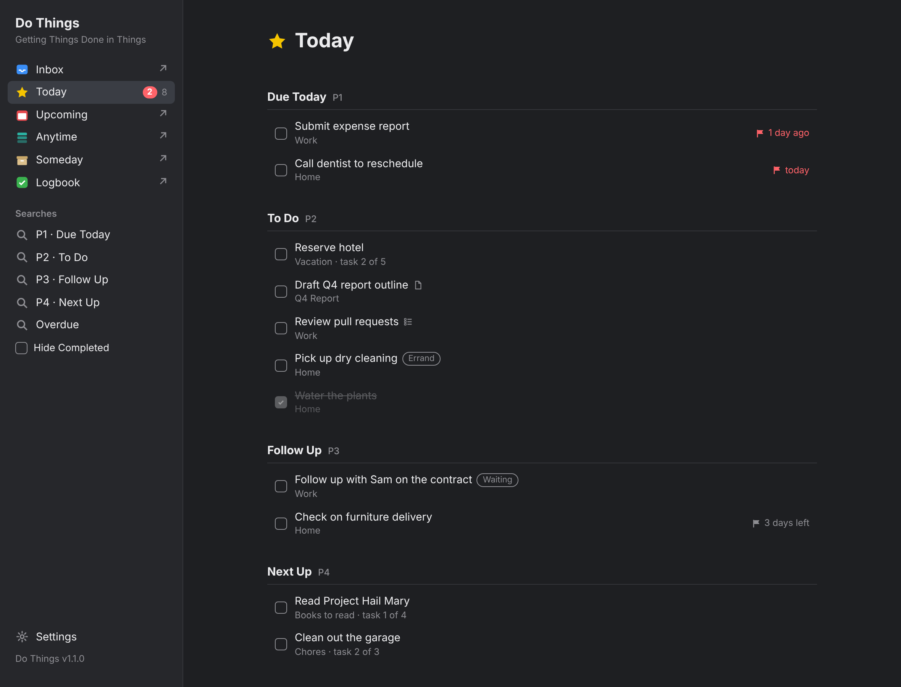

# Do Things

See [CHANGELOG.md](CHANGELOG.md) for what's new in each version.

## Why this exists
Things 3 is good at capturing and organizing everything you might do. Do Things is for the other half of the job: doing it.

It is a companion view for your Things Today list. It sorts today's tasks into five priorities:
- **P1 Due Today:** must be done today.
- **P2 To Do:** today's planned work.
- **P3 Follow Up:** waiting on someone, or to check on.
- **P4 Next Up:** the next step of a lower-priority project you want to be reminded of.
- **P5:** a fifth, lowest priority, with no name until you give it one.

The names are yours to change in Settings; the tags stay `P1` to `P5`.

You work from the top down. Reprioritizing is a drag. The housekeeping that usually eats into the day is done for you: tagging, deadlines, and starting the next step of a project.

Everything stays in Things. Do Things holds no tasks of its own. It reads your Things data and makes every change through Things itself, so Things on your Mac, iPhone and iPad shows the same tasks with the same tags and dates.

## What it does


*Today in Do Things, with sample data. "Reserve hotel" is the next step of the sequential **Vacation** project (task 2 of 5; "Book flights" is done). Below Follow Up, the Next Up group holds one reminder from each project tagged `Next Up` (listed in Settings with P4): the next book in **Books to read** (task 1 of 4) and the next chore in **Chores** (task 2 of 3). "Water the plants" was checked off today.*

- **Today in five priorities.** Today's tasks are grouped by their `P1` to `P5` tags, under the names set in Settings (a priority with no name shows just its tag). Within each group you set the order by dragging. Tasks you haven't ordered follow Things' Today order, and tasks from the same project keep their order from that project.
- **Priority rules kept for you.** On every refresh (page load, returning to the window, and every 60 seconds):
  1. A task due today or overdue is tagged P1 (unless **Auto assign due and overdue tasks P1** is off in Settings).
  2. A task with more than one P tag keeps only the highest.
  3. A Today task with no P tag gets the priority chosen in Settings (P2 to start), or, in a sequential project, the priority set for the project's tag.
  4. A task with no start date that is due today or overdue gets a start date of today, so it is in Things' Today too.
- **Move tasks between priorities.** Dragging a task to another group replaces its P tag.
  - **Moving into P1** gives it a deadline of today if it has none.
  - **Moving out of P1** removes a deadline of today or earlier. If the task was in Today only because of that deadline, it gets a start date of today so it stays in Today.
  - **A deadline after today** is always kept.
  - With **Auto assign due and overdue tasks P1** off, moves never change the deadline.
- **Sequential projects.** In **Settings › Sequential projects**, list the project tags you use in Things, each with a priority (for example `Sequential` → P2 for work in order, and `Next Up` → P4 for lower-priority projects you want to be reminded of, such as books to read, shows to watch or chores to do). Tag a Things project with one of them and Do Things brings its tasks into Today one at a time, in project order. When you check one off, the next one starts. Each such task shows its place, for example "Vacation · task 2 of 5". If you uncheck a task, the task it started goes back. The project's tasks in Today without a P tag, including ones you dated yourself, get the priority set beside the tag. A project with two listed tags uses the higher priority; Do Things never changes a project's tags. The list starts empty.
- **Saved searches.** Build your own searches in the sidebar from priority, tag, text (in the title or notes), project or area, and an overdue deadline. A search covers Today or all open tasks, and lists the tasks that match every criterion you set; within one criterion, any of the values you choose matches (for example tags Calls or Errand). You start with P1, P2, P3, P4 and Overdue, which you can change or delete like any other. The **Searches** heading collapses the list (▾/▸), and **+** starts a new one. **Hide Completed** hides tasks checked off today, in every view. **Hide Empty** hides Today's priority groups that show no tasks (they reappear while you drag a task, so you can drop it into any priority).
- **Reset a sequential project.** If more than one task of such a project ends up in Today, open the one you want to keep and click **Reset other tasks**. Do Things first shows which tasks will go back to Anytime, and does nothing until you click **Reset**. Every other task of that project in Today goes back to Anytime, except tasks with a deadline, which follow their own dates. The kept task becomes the one in progress. The returned tasks keep their place in the project, and when the kept task is done the next one started is the first undated task in project order, so check the project's order in Things afterwards.
- **Calendar events in Today.** Turn on **Settings › Calendar events** and today's events from macOS Calendar appear above the priority groups, as in Things: all-day events first, then by time, each in its calendar's color. Ended events are dimmed, the current one's time is red, and clicking one opens it in Calendar. Choose which calendars to show. Do Things only reads your calendars.
- **Complete and edit in place.** Check a task off from Do Things. Click a task to edit its title, notes, tags, When, deadline, project or area, heading and priority. **Move to Trash** in the same card moves an open task to Things' Trash after you confirm it (put it back from the Trash in Things if needed). **Open in Things** handles everything else.
- **Help one click away.** The version at the bottom of the sidebar opens this guide on GitHub.
- **Looks like Things.** Rows show tags, deadline flags ("2 days left", or red "1 day ago"), start-date badges, and icons for notes, checklists and repeating tasks. Where a search can list more than one priority, each task's priority shows as a colored pill with its name, set apart from the gray tags. A task with a reminder shows its time in small gray text after the title (for example "2:30 PM"), and the editor shows it on the When line; reminders are set in Things. Dark and Light appearance.
- **Things' other lists one click away.** Inbox, Upcoming, Anytime, Someday and Logbook (marked ↗) open in Things. The sidebar shows the Inbox count and Today's due and open counts, as in Things.

## Advantages over Things
| | Things 3 | Do Things |
|---|---|---|
| **Priorities** | No priority field. Today is one list. | Four priority groups. Drag between them, and tags and deadlines follow the rules above. |
| **Moving tasks** | Moving a task in Today changes only its position. | Moving a task to another group changes its priority and, where the rules say so, its deadline and start date. |
| **Sequential projects** | Every task in a project is available at once, and a someday list is easy to forget while a reminder for every item clutters Today. | A project with a tag you list in Settings releases one task at a time into Today, in order, at the priority you chose for that tag, and shows each task's place in the project. A low priority (such as P4) keeps just the next item of a someday list below the day's real work. |
| **Saved searches** | Quick Find and tag filters, but no saved searches in the sidebar. | Your own searches by priority, tag, text, project and deadline, one click away. |
| **Due tasks** | A due task can be removed from Today and stays out of view. | Anything due today or overdue is always in Today, in P1. |
| **Project order in Today** | Today has its own order, separate from each project's order. | Tasks from the same project keep their project order within a priority. |

Do Things doesn't replace Things. Planning, projects, areas, repeating tasks, checklists and syncing stay in Things.

## 1. Requirements
- A Mac with **Things 3** (latest version).
- The macOS **Command Line Tools**, which include Python 3. If `/Library/Developer/CommandLineTools/usr/bin/python3` doesn't exist, run `xcode-select --install` in Terminal.
- No other software. Do Things uses only Python's standard library.

## 2. Install (download)
1. Open the latest release: <https://github.com/CyberAdvisor/DoThings/releases/latest>.
2. Under **Assets**, download **Source code (zip)**.
3. Double-click the zip to unzip it. You get a folder named like `DoThings-1.0.0`.
4. Rename the folder to `DoThings`.
5. Move it into a `Projects` folder inside your Documents folder, so its path is `~/Documents/Projects/DoThings`. Create the `Projects` folder if you don't have one.

The commands in this guide assume that location. If you put it elsewhere, change the `cd` path in them.

**Updating to a new version:**
1. Stop Do Things (see section 7).
2. Download and unzip the new release.
3. Copy these files from your old `DoThings` folder into the new one: `auth_token.txt`, `task_order.json`, `sequence_pulls.json`, `settings.json` and `searches.json`. These are your token, your saved order, your sequential-project progress, your settings and your saved searches (any that don't exist yet are created when needed).
4. Replace the old folder with the new one.

## 3. Prepare Things and your Mac
1. **Create the priority tags.** In Things, open **Window › Tags** and create five tags named exactly `P1`, `P2`, `P3`, `P4` and `P5`. Things ignores tags that don't exist, so Do Things can't assign priorities until these do. Do Things shows how to create them if any are missing.
2. **Optional: tags for sequential projects.** Create a tag in Things for each kind of project you want worked one task at a time (for example `Sequential` and `Next Up`), add it to those projects, and list it in Do Things' **Settings › Sequential projects** with a priority (section 4). Names must match exactly.
3. **Allow Terminal to read Things' data.** Things keeps its data in a protected folder.
   - The first time you run Do Things (or `debug_things.py`) from Terminal, macOS asks whether Terminal may access data from other apps. Click **Allow**.
   - If you missed or declined the prompt, open **System Settings › Privacy & Security › Files & Folders**. Under **Terminal**, turn on **Data shared by Things and affiliated apps**.
   - Without this, Do Things reports "Things database not found".
4. **Shortcuts needs the same permission.** Terminal's access doesn't cover the Do Things shortcut (section 7). Expect the same macOS prompt, for Shortcuts, the first time the shortcut runs.
5. **Optional: allow Do Things to read your calendars.** Only needed for calendar events in Today. When you turn on **Settings › Calendar events**, macOS asks whether Terminal (or Shortcuts) may access your calendars. Click **Allow**.
   - If you missed or declined the prompt, open **System Settings › Privacy & Security › Calendars** and turn on **Terminal** (and **Shortcuts**).
6. **Allow Do Things to move tasks to the Trash.** Things' URL commands can't delete, so **Move to Trash** asks Things through AppleScript. The first time you use it, macOS asks whether Terminal (or Shortcuts, if you started Do Things from the shortcut) may control Things. Click **Allow**.
   - If you missed or declined the prompt, open **System Settings › Privacy & Security › Automation**. Under **Terminal** (and **Shortcuts**), turn on **Things3**.
   - Without this, Do Things says Things didn't apply the move to the Trash, and the task stays.

## 4. First run and the auth token
1. Open Terminal and start Do Things:
   ```
   cd ~/Documents/Projects/DoThings
   /Library/Developer/CommandLineTools/usr/bin/python3 serve.py
   ```
   It opens `http://127.0.0.1:8765` in your browser.
2. The first time, it shows a setup screen asking for your Things auth token. Do Things needs it to change tags and dates in Things.
   - In Things, choose **Things › Settings › General**.
   - Turn on **Enable Things URLs**.
   - Click **Manage** and copy the authorization token.
3. Paste the token into the setup screen and click **Save**.
   - It is stored in `auth_token.txt` in the Do Things folder, readable only by your account.
   - It is never committed to git or written to a log.
4. To stop Do Things, press Ctrl-C in Terminal.

**Settings** at the bottom of the sidebar lets you replace the token, switch between **Dark** (the default) and **Light** appearance, and set up the priorities:
- **A name for each priority,** shown on Today's group headers and on priority pills. Leave it empty to show just the tag (P5 starts that way). Next to each name, Settings shows whether its tag exists in Things.
- **Auto assign due and overdue tasks P1.** On by default. When off, a due task keeps its priority, and moving a task into or out of P1 leaves its deadline alone.
- **Assign priority … to new Today tasks.** The priority a Today task without a P tag gets (P2 to start). Tasks of sequential projects get their tag's priority instead.

**Sequential projects** in Settings lists the project tags that make a project work one task at a time:
- Click **+ Add tag**, type the tag exactly as it is named in Things, and choose the priority its tasks get. Remove a tag with **×**. The list starts empty.
- Next to each tag, Settings shows whether it exists in Things. A tag that doesn't exist only means no project uses it yet; Today shows an amber notice naming it, with a link back to Settings.
- Changing a tag's priority applies to tasks that get their priority from now on; a task already started keeps its tag. Removing a tag stops its projects being worked one at a time, and Do Things no longer undoes their tasks; add it back and they continue where they were.

**Calendar events** in Settings shows today's events from macOS Calendar at the top of Today:
- Turn on **Show calendar events in Today**. The first time, macOS asks whether Terminal (or Shortcuts) may access your calendars; click **Allow**. Settings then shows "✓ Calendar access allowed."
- Uncheck any calendar you don't want in Today. New calendars are shown until you uncheck them.
- If access is off, Settings and Today say how to turn it on (System Settings › Privacy & Security › Calendars).

Settings are saved as you change them, in `settings.json` in the Do Things folder.

**Searches** in the sidebar are yours to build:
- Click **+** next to the Searches heading for a new search, or open a search and click **Edit search**. The builder shows the tasks the search lists as you choose.
- **Covers:** Today, or all open tasks. **Priority:** any of the ones you pick (none = any priority). **Tag**, **Project:** any of the ones you add. **Text:** found in the title or notes, ignoring case. **Deadline:** Any, or Overdue (before today). A task must match every one you set.
- **Save** keeps it (each search needs its own name); **Cancel** leaves it as it was; **Delete search** asks before deleting. Your tasks are never changed by a search.
- A tag or project that's no longer in Things is marked "Not found in Things" in the builder and matches nothing; remove it with **×**.
- Click the **Searches** heading to collapse or expand the list; your browser remembers it.
- Searches are saved in `searches.json` in the Do Things folder. Until you change one, you have the five Do Things started with.

If Things doesn't apply an automatic update, Do Things pauses automatic updates and shows a red bar. The bar lists what to check, and has a **Retry** button and a button to re-enter the token.

## 5. Test manually before automating
To check your setup without changing anything:
```
cd ~/Documents/Projects/DoThings
/Library/Developer/CommandLineTools/usr/bin/python3 debug_things.py
```
It changes nothing in Things or in Do Things. It shows:
- where the Things database is;
- whether the database has the layout Do Things expects;
- any missing P tags;
- every Today task, with the change the rules would make;
- which sequential-project tags listed in Settings are missing in Things;
- each sequential project's tag, priority and task in progress.

`debug_calendar.py` checks, also without changing anything, that Do Things can read today's calendar events:
```
cd ~/Documents/Projects/DoThings
/Library/Developer/CommandLineTools/usr/bin/python3 debug_calendar.py --hide-titles
```
If macOS hasn't asked yet, it asks whether Terminal may access your calendars. It shows whether access is granted, the calendars it sees, today's events as Today shows them and how long reading them took. Leave out `--hide-titles` to see event titles.

## 6. Project location and development workflow (clone to change Do Things)
If you want Do Things to work differently, work from a clone instead of a download.

1. On GitHub, **fork** `CyberAdvisor/DoThings` to your own account.
2. Clone your fork into the usual location:
   ```
   git clone https://github.com/<your-account>/DoThings.git ~/Documents/Projects/DoThings
   ```
   If you just want to follow the latest changes without forking, clone `https://github.com/CyberAdvisor/DoThings.git` instead and update with `git pull`.
3. Keep this one folder as your only copy. It is where you edit, test, commit and run.
4. Workflow:
   1. Edit.
   2. Test with the verification commands in `AGENTS.md`.
   3. Commit.
   4. Push.
5. Read `AGENTS.md` before changing anything. It lists the safety rules (for example, Do Things never writes to the Things database directly) and the project conventions.
6. **Releases:** bump `VERSION` and push to `main`.
   - The `Release` GitHub Action then tags that commit `vX.Y.Z` and publishes a GitHub release, using the commit message as the notes.
   - Don't create tags by hand, or the action skips that version.
   - In a fork, turn on Actions under the fork's **Actions** tab for this to run.

To make changes with Claude's help, see **Customizing this with Claude** below.

## 7. Start with Shortcuts
Do Things is a small server that runs while you use it. A shortcut starts it in the background and opens the page, without Terminal.

1. **Allow scripts in Shortcuts:** open **Shortcuts**, choose **Shortcuts › Settings › Advanced**, and turn on **Allow Running Scripts**.
2. **New shortcut:** choose **File › New Shortcut** (⌘N), click the title at the top, and name it **Do Things**.
3. **Add the action:** in the action search on the right, type **Run Shell Script** and drag it into the shortcut.
4. **Set up the action:** leave Shell as **zsh** and Input as nothing. Replace the sample text with this one line:
   ```
   cd ~/Documents/Projects/DoThings && nohup /Library/Developer/CommandLineTools/usr/bin/python3 serve.py >> run.log 2>&1 &
   ```
5. **Choose how to launch it (optional):**
   - **Pin in Menu Bar:** click **ⓘ** (Shortcut Details) at the top right and turn it on.
   - **Dock:** choose **File › Add to Dock**.
   - **Spotlight:** finds the shortcut by name.
6. **Run it:** click **▶︎**.
7. **Allow access:** the first time, macOS asks whether Shortcuts may access data from other apps. Click **Allow**. Your browser opens Do Things.
   - **If you missed or declined the prompt:** open **System Settings › Privacy & Security › Files & Folders**. Under **Shortcuts**, turn on **Data shared by Things and affiliated apps** and **Documents**. Then stop Do Things (see below) and run the shortcut again.

Running the shortcut while Do Things is already running just opens the page again.

**Start automatically (optional):** in Shortcuts, open **Automation**, create a Personal Automation (for example **Time of Day**, **Daily**), turn **Ask Before Running** off, and have it run the **Do Things** shortcut.

**Stop Do Things:** in Terminal, run `lsof -ti tcp:8765 | xargs kill`.

**If Do Things shows "Things database not found"** after starting from the shortcut, Shortcuts doesn't have access yet. Turn on the two switches in step 7, then stop Do Things (above) and run the shortcut again. A server already running without access keeps failing until it is restarted.

## Files
| File | Purpose |
|---|---|
| `README.md` | This guide |
| `CHANGELOG.md` | What changed in each version, newest first |
| `AGENTS.md` | Rules and checks for contributors and AI agents |
| `CLAUDE_CONTEXT.md` | Primer for a fresh Claude conversation: data model, architecture, gotchas |
| `LICENSE` | MIT license |
| `VERSION` | Project version |
| `.gitignore` | Keeps logs, the order file and the token out of git |
| `requirements.txt` | States that only the standard library is used |
| `.github/workflows/release.yml` | GitHub Action that tags and releases each new version pushed to `main` |
| `common.py` | Paths, version, logging, read-only Things database access, Things URL commands, order file, auth token |
| `priority_check.py` | The priority, move and sequential-project rules, settings validation, grouping and ordering (pure logic) |
| `search_check.py` | Saved searches: the default searches, checking a search, which tasks it lists and in what order, and the line describing it (pure logic) |
| `serve.py` | Entry point: local server and JSON API |
| `debug_things.py` | Read-only diagnostic |
| `calendar_check.py` | Calendar event rules: checking what Calendar returned, which events show, their order, time labels and ended/now states (pure logic) |
| `debug_calendar.py` | Read-only check that today's calendar events can be read |
| `index.html` | The page: sidebar, task lists, drag-and-drop, editor, settings and token setup |
| `screenshots/today.png` | The Today screenshot shown in this guide (sample data) |
| `test_priority_check.py` | Tests for the rules |
| `test_search_check.py` | Tests for the saved searches |
| `test_common.py` | Tests for token handling, dates, time zone, URLs, saved files and database queries |
| `test_serve.py` | Tests for the server against a mock Things database |
| `test_calendar_check.py` | Tests for the calendar event rules |
| `test_debug_calendar.py` | Tests for the calendar diagnostic's report (Calendar mocked) |
| `errors.log`, `run.log` | Runtime logs (untracked). `errors.log` is capped at 1 MB, with the previous one kept as `errors.log.1` |
| `task_order.json` | Saved order within each priority; tasks that leave Today are dropped from it (untracked) |
| `sequence_pulls.json` | The task Do Things started in each sequential project, so it can be undone (untracked) |
| `settings.json` | Your settings: priority names, Auto assign P1, the priority for new Today tasks, the sequential-project tags and calendar events (untracked) |
| `searches.json` | Your saved searches, in sidebar order (untracked) |
| `auth_token.txt` | Things auth token, owner-only permissions (untracked) |

## Safety notes
- The Things database is opened read-only. All changes go through Things' own URL commands, as if you'd made them in Things. The one exception is **Move to Trash**: Things' URL commands can't delete, so Do Things asks Things through AppleScript, which moves the task to Things' Trash (never erases it). It runs only after you confirm it in the card, only for an open task, and is confirmed like any other change.
- A change counts as done only after it appears in Things' data. The saved order is updated only after a move is confirmed.
- If an automatic update isn't confirmed, automatic updates pause until you click **Retry**, save a new token or restart Do Things. The failure is logged once. Changes you make yourself are still sent, each with its own message if it fails.
- Tags are written as a full list, so your other tags are kept. A tag containing a comma can't be written safely, so such a task is logged and skipped.
- In a sequential project, Do Things only ever undoes a task it started itself, and not if you've changed that task's date since. **Reset other tasks** changes other tasks of the project only when you click **Reset**, after showing which ones.
- Calendar events are read only: Do Things never adds, changes or removes an event. Calendar is read only while events are turned on, and only turning them on in Settings can make macOS ask for access.
- Searches only read: building, previewing, saving or deleting a search never changes a task.
- Do Things never changes projects, only tasks. A project with two of the tags listed in Settings keeps both; the higher priority is used.
- The server listens only on your Mac (`127.0.0.1`). It accepts only requests addressed to itself, and only accepts changes carrying a header that other websites can't add.
- The auth token is never written to logs.

## Limitations
- Things' database layout isn't published and could change with a Things update. `debug_things.py` reports missing columns.
- Only to-dos are listed, not projects or headings.
- Today is worked out from start dates and deadlines. It can differ from Things in edge cases, such as tasks inside a project that is itself scheduled later. By design, Do Things also lists due tasks you've removed from Things' Today.
- Searches are listed in the order they were added; they can't be reordered yet. Choosing an area in a search matches tasks directly in that area, not the tasks of projects inside it.
- Changes show immediately but are confirmed with Things in the background, one at a time. While a change is pending, that task can't be dragged or opened. A change Things doesn't apply within 5 seconds is undone on the page.
- The editor can't edit a task's checklist, change repeat settings or attachments, or take a task out of a project, area or heading. Use **Open in Things** for those.
- Do Things runs only on the Mac where Things is installed. It has no iPhone or iPad version, but changes it makes appear there through Things' sync.

## Reporting issues and errors
Open an issue at <https://github.com/CyberAdvisor/DoThings/issues/new>. Include:
1. **What happened and what you expected,** and the steps to make it happen again.
2. **Versions:**
   - Do Things, shown at the bottom of the sidebar or in the `VERSION` file.
   - macOS, from  › About This Mac.
   - Things, from Things › About Things.
3. **The diagnostic output:**
   ```
   cd ~/Documents/Projects/DoThings
   /Library/Developer/CommandLineTools/usr/bin/python3 debug_things.py > debug.txt
   ```
   It lists your Today task titles, so remove or replace any you'd rather not share before attaching it.
4. **Recent errors:** the last lines of the logs, from `tail -n 50 errors.log` and `tail -n 50 run.log`.

**Never** attach or paste `auth_token.txt` or your auth token. Do Things never writes the token to its logs, but check anything you attach for task titles you'd rather keep private.

## Customizing this with Claude
1. Clone the repository (section 6).
2. Start a new conversation with Claude, paste in `CLAUDE_CONTEXT.md` and `AGENTS.md`, and describe the change you want.
3. Ask Claude to:
   - confirm the design and file list before writing code;
   - run the verification commands in `AGENTS.md`;
   - follow the release steps: version bump, change logs (each file and `CHANGELOG.md`), then commit and push. The Release action creates the tag and release.
